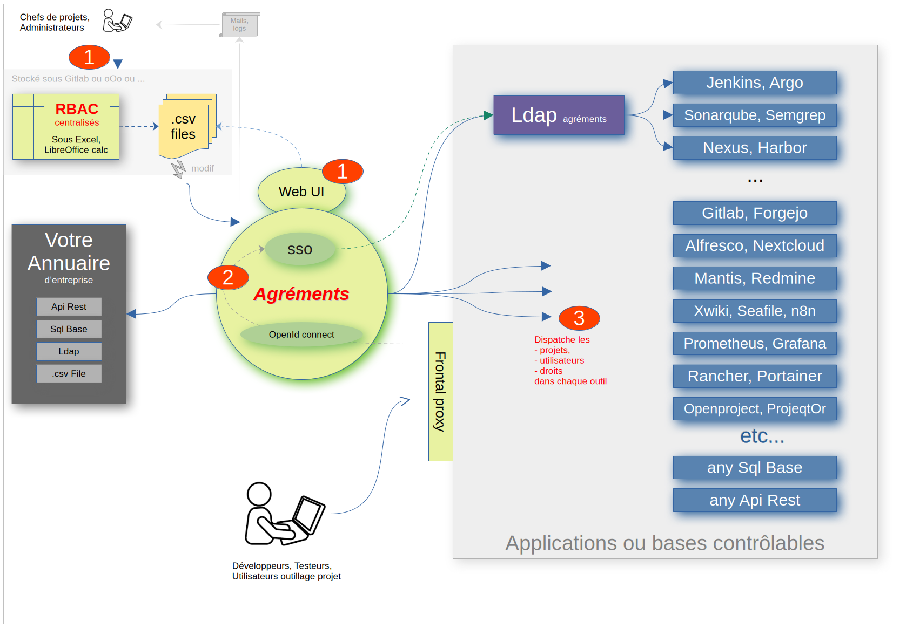

# Agréments : a Tool to centralize RBAC, Auth

***

***

This Golang application objectives are :

* Centralize management of projects-users-rbac of others tools
* Single Sign On (SSO) server, client, based on Openid Connect,
* Use and fill Openldap as annuary for all tools and sso
* Automate transfert of some users,groups from your annuary to Ldap
* Read RBAC from .csv files ; it can be generated by excel/calc tool script
* or Read RBAC from markdown file, one by project, inside source code
* or Edit RBAC from the Web UI, with Projects Portfolio

> RBAC = Role Base Access Control : Set of Associations ( User-Project-Role ) 

## Architecture

## Build, Dependencies

- Golang
- Vue3.js
- Zitadel ( Go library OpenIdConnect client & server )
- Self maded "embed" html tag : .vue file managed internally
- Ldap
- Yaml
- Resty 
- Jwt

## Reverse Proxy Oidc 

- See brother project

## Anuary

- Read your anuary with REST, SQL, LDAP protocol, or .csv Loader
- Import from your anuary to our openldap : Users and static groups

## SSO OpenId connect

- Internal or external 
- Authentication : login & password
- TODO : Option TOTP , hardware key, card, browser Id  
- Renew password by mail

## Web UI

- login form ( internal sso provider ) 
- TODO : projects portfolio 
- TODO : create and remove project 
- rbac mapping for each tool
- centralize : create user, projects form
- TODO : remove user batch
- TODO : logout chains
- TODO : batch for coherence checks , password expiration
- ldap browse and edit
- your annuary browser

## Connectors

To manage Users,Projects,RBAC 
- Mantis
- Gitlab
- OpenLdap
- Generic REST API
- Generic SQL Base
- TODO : Others, In Progress 